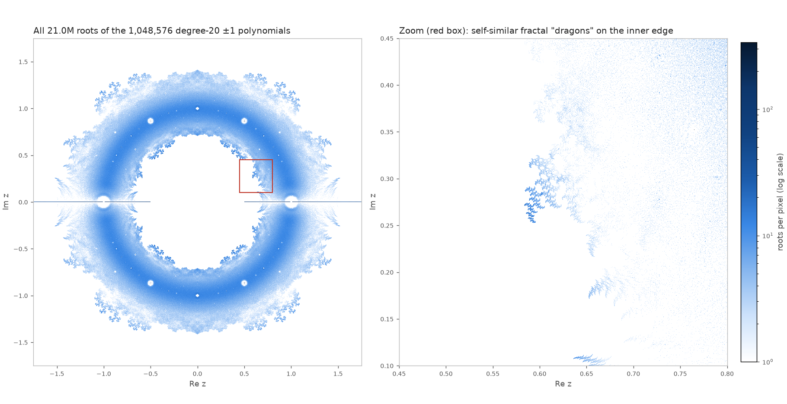

# L001 · roots of Littlewood polynomials

## Goal
A visual test of the lab workflow (thread [[thread:1]]): take a very simple random-looking object and show that
it hides a lot of structure. The object: **every** polynomial of degree $n=20$ whose coefficients are all $\pm1$,
$$p(z) = \sum_{k=0}^{20} a_k z^k,\qquad a_k\in\{-1,+1\}.$$
Plot where all their complex roots land.

## Setup
- Leading coefficient fixed to $+1$ ($p$ and $-p$ have the same roots), giving $2^{20} = 1{,}048{,}576$ polynomials
  and $20{,}971{,}520$ roots.
- Roots are the eigenvalues of the companion matrices, computed in batches of 16384 with `np.linalg.eigvals`.
- Exhaustive enumeration, so there's **no randomness and no seed**. 45 s on one CPU core.
- Config: [[file:labs/001-roots-of-littlewood-polynomials/config.yaml]].
  Code: [[file:labs/001-roots-of-littlewood-polynomials/run.py]] (`python run.py`).
- Outputs: `results.json` (committed) and `outputs/roots.npy` (complex64, 161 MB, git-ignored, only on gorkamunoz's machine).
- Colour: 2D histogram of root positions with a log colour scale. Left panel: 1400² pixels over $[-1.75,1.75]^2$;
  right panel: 700² pixels over the red box.

## Results

What the figure shows (all **observed**, at $n=20$):
1. **A ring.** Every root lies in the annulus $0.5 < |z| < 2$ (observed min $|z| = 0.50000$, max $= 1.99999$).
   This bound is **proved** and elementary: if $|z|<1/2$ then $|a_0| = 1 > \sum_{k\ge1}|z|^k$, so $p(z)\neq0$.
   The bound for $|z|>2$ follows by applying the same argument to $z^n p(1/z)$.
   The roots pile up on the unit circle: 59% have $||z|-1|<0.1$ and 35% have $||z|-1|<0.05$.
2. **Holes at roots of unity.** There are empty discs around $\pm1$, $\pm i$, $e^{\pm i\pi/3}$, $e^{\pm 2i\pi/3}$, and
   smaller ones around higher-order roots of unity. Often the root of unity itself *is* a root, and it shows as a lone dot in
   the middle of its hole. For example, $e^{i\pi/3}$ is hit to within $10^{-8}$, because $z^2-z+1$ divides some $\pm1$ polynomials.
   Near $z=1$ the closest *non-real* root is 0.058 away. The real roots, drawn as the dark line on the axis, do reach $z=1$ (0.009).
3. **Fractals on the edges.** The inner and outer boundaries are covered in self-similar "dragon" shapes (right panel).
   The literature says (**not checked here**) that the limiting root set is related to the attractor of the
   iterated function system $z\mapsto \pm1 + qz$. The literature is Odlyzko & Poonen 1993 and Bousch; both still need to go into `refs/`.
4. **Few real roots.** On average a polynomial has 2.15 real roots (2.08 at $n=18$), against 20 complex roots.

| metric | n = 18 | n = 20 |
|---|---|---|
| polynomials | 262,144 | 1,048,576 |
| min / max $\lvert z\rvert$ | 0.500 / 2.000 | 0.500 / 2.000 |
| fraction with $\lvert\lvert z\rvert-1\rvert<0.1$ | 0.556 | 0.589 |
| mean real roots per polynomial | 2.08 | 2.15 |
| compute time | 9 s | 45 s |

(The $n=18$ column comes from a first run of the same script with `degree: 18`. `results.json` holds the $n=20$ values.)

## Conclusion
**Observed:** polynomials with random $\pm1$ coefficients have roots that cluster tightly on the unit circle.
The cluster has empty holes at roots of unity and fractal boundaries. The annulus $1/2<|z|<2$ is **proved** (see above).
The connection to fractal attractors is **known in the literature but not verified here**.

## Next steps
- Animate the picture as $n$ grows from 10 to 24, to see whether the holes shrink and the ring sharpens.
- Colour each root by which coefficient pattern produced it, or use coefficients from $\{-1,0,1\}$ to get a different fractal.
- Add the Odlyzko–Poonen and Borwein–Jörgenson papers to `refs/` if this becomes more than a demo.
